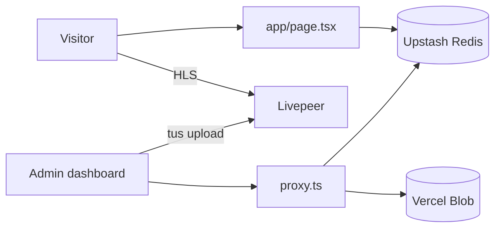

<p align="center">
  
</p>

<p align="center">
  
  
  
  
  
  
  
</p>

# Cells Edition

Portfolio site for Celeste Cuestas, a video editor from Honduras. Her reels ride a WebGL helix, condense out of cloud banks at either end and open into a fullscreen player on tap, streamed from Livepeer as adaptive HLS straight into three.js textures. A private dashboard lets her manage the library, the hero overlay, a watermark and her client projects without redeploying.

> [!TIP]
> Live at https://www.cellsedition.com.

## Features

- **Spiral of reels**: portrait and landscape clips share one helix, every clip shows once before any repeats, and wheel, drag or arrow keys scrub the strip.
- **Cloud banks**: a custom shader morphs leaving cards into puffs of vapour and condenses new ones out of them.
- **Fullscreen lightbox**: a tap grows the card from its exact on-screen rect into a real player with a seekable timeline, title and description.
- **Direct uploads with a burned-in watermark**: videos go from the browser straight to Livepeer over tus, after the logo is drawn onto every frame with WebCodecs.
- **Admin dashboard**: library, hero overlay (bio, tools, socials, CV), watermark, a Kanban client board and per-section access for a second account.
- **Cookieless analytics**: daily views and unique visitors by country, browser, device and referrer, with no IP or user agent stored.
- **Small surprises**: a custom cell-shaped cursor, and typing "cafe" pours the whole page into espresso.

## How it works



- **Video bytes never touch the app**: uploads go from the browser to Livepeer, playback goes from Livepeer to the browser, and Redis only keeps the library entries.
- **Only visible cards decode**: a card shows its poster until it is on screen, card streams are capped at a low rendition, and a phone decodes one card at a time.
- **No two cards ever cross**: card spacing, curl and climb are tuned together and checked numerically for mixes of aspect ratios.
- **Livepeer is the source of truth**: each dashboard load reconciles the Redis library with the assets that exist upstream.
- **Stateless sessions**: two fixed accounts, a signed cookie, scrypt hashes in Redis, and `proxy.ts` maps each admin route to a section and an access level.

## Stack

| Layer     | Choice                                              |
| --------- | --------------------------------------------------- |
| Framework | Next.js 16 (App Router), React 19, TypeScript       |
| 3D        | three.js with custom GLSL shaders                   |
| Video     | Livepeer (hosting, encoding), hls.js, tus-js-client |
| Data      | Upstash Redis, Vercel Blob                          |
| UI        | Tailwind CSS 4, shadcn/ui, lucide-react             |
| Hosting   | Vercel                                              |

## Run it locally

Needs Node.js 20.9+, pnpm 11, a Livepeer API key and an Upstash Redis database.

```bash
pnpm install
pnpm dev
```

Put `ADMIN_PASSWORD`, `LIVEPEER_API_KEY`, `KV_REST_API_URL`, `KV_REST_API_TOKEN` and `BLOB_READ_WRITE_TOKEN` in a gitignored `.env.local`.

## Project structure

```
app/
  components/   WebGL spiral, overlay, cursor, admin sections
  admin/        sign-in page and dashboard
  api/          admin routes and the visit beacon
lib/            Redis, Livepeer, auth, analytics, watermark
lib/shaders/    card and grid GLSL shaders
public/         wordmark, tool and social icons
proxy.ts        auth and per-section access for /admin
```
